# Photos & Videos

The photos app for LuneOS: the pictures and videos on the device and in
the cloud accounts, by album, as webOS 3.0's Photos & Videos showed them,
with slideshows and exhibition mode.

A QML app with no C++ of its own. The library comes from the media indexer
and from `com.palm.service.photos`, which syncs the cloud accounts' albums
down and sends additions and deletions back up.

## Screenshots

<table>
  <tr>
    <td align="center" colspan="2">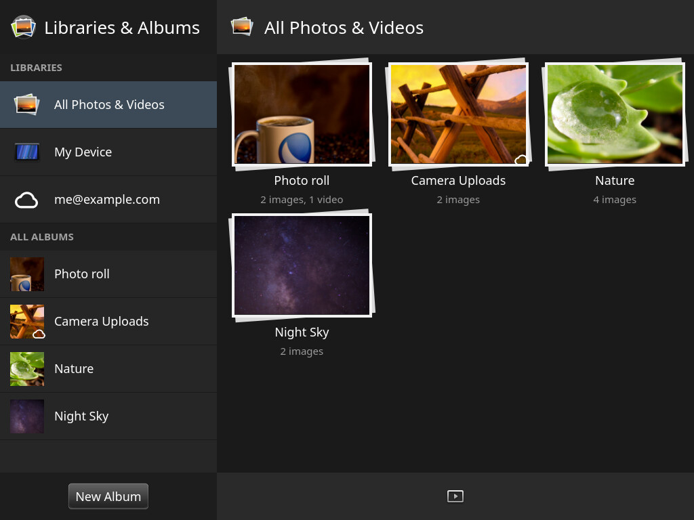</td>
  </tr>
  <tr>
    <td align="center" colspan="2">Libraries and albums, HP TouchPad (1024x768)</td>
  </tr>
  <tr>
    <td align="center">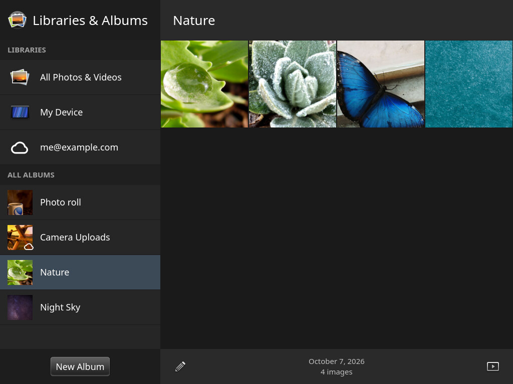</td>
    <td align="center">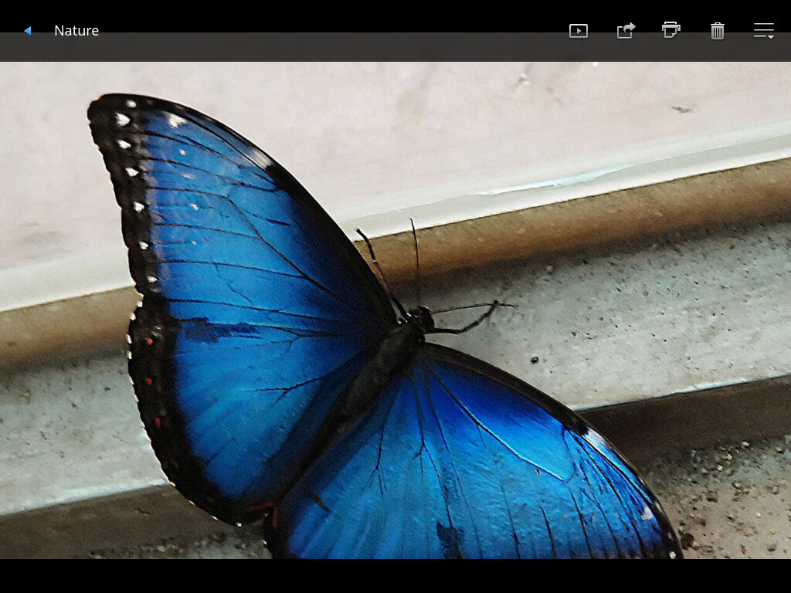</td>
  </tr>
  <tr>
    <td align="center">An album</td>
    <td align="center">A picture, with its bar</td>
  </tr>
  <tr>
    <td align="center">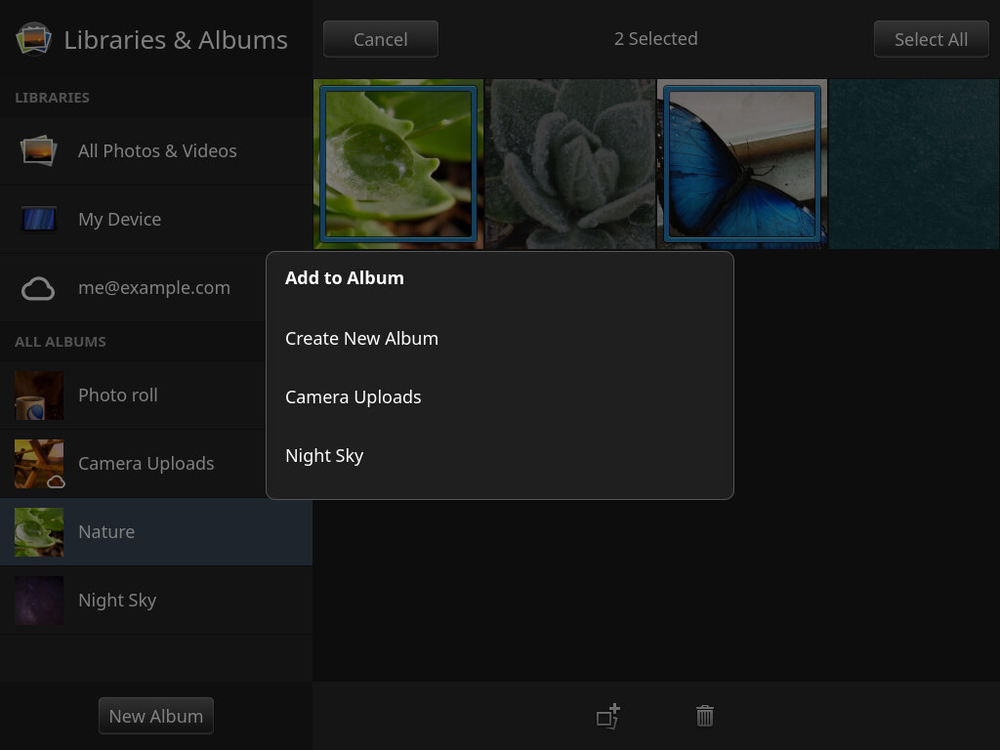</td>
    <td align="center"></td>
  </tr>
  <tr>
    <td align="center">Two pictures selected, added to another album</td>
    <td align="center">Exhibition: the slideshow on the dock</td>
  </tr>
</table>

| mindphone (480x800) | | | |
|:---:|:---:|:---:|:---:|
| 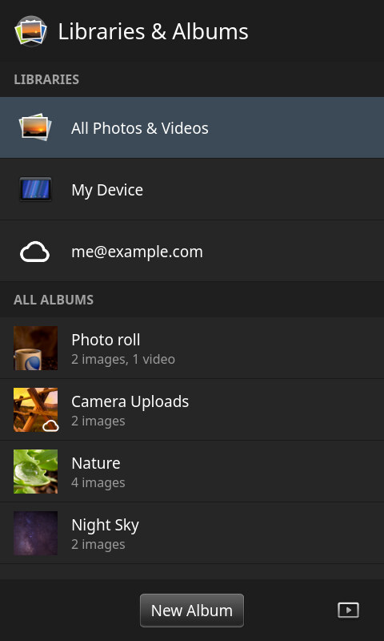 | 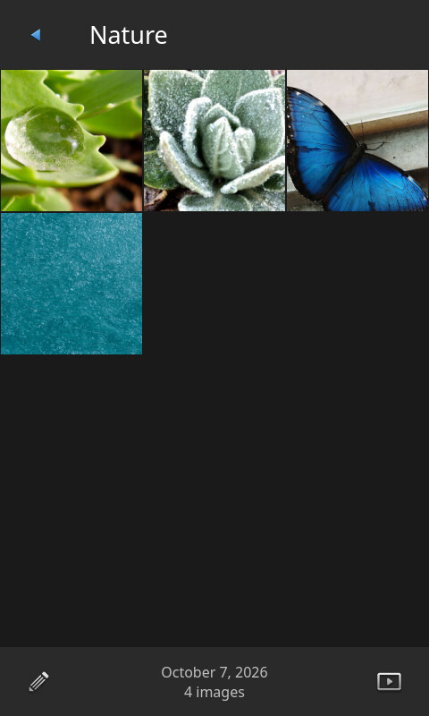 | 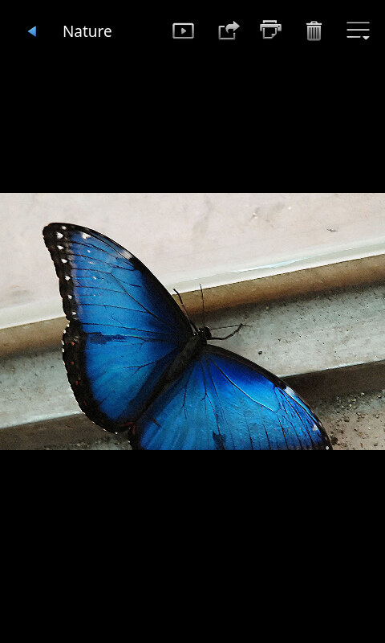 | 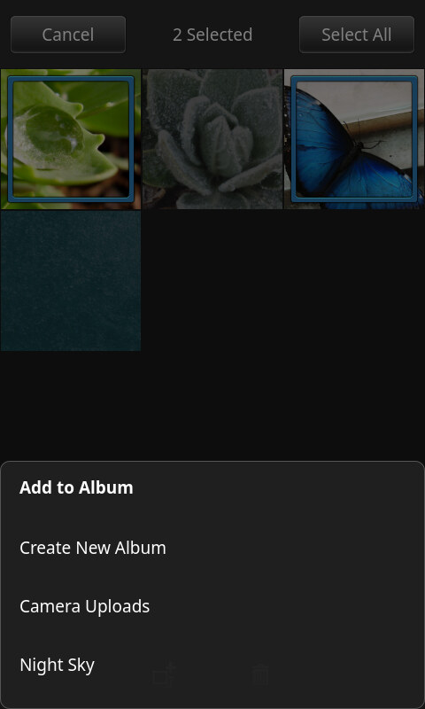 |
| Libraries and albums | An album | A picture | Add to album |

| Q25 (720x720) | | | |
|:---:|:---:|:---:|:---:|
| 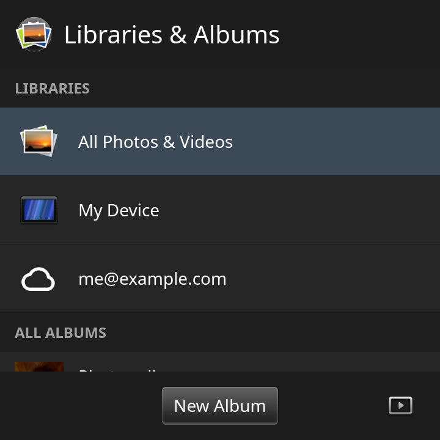 | 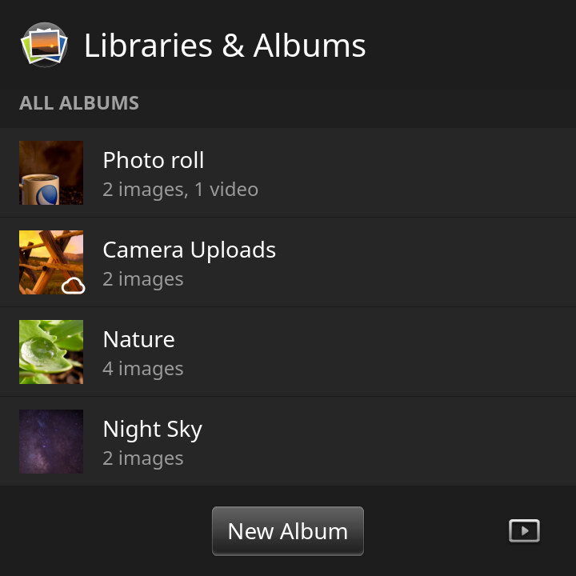 | 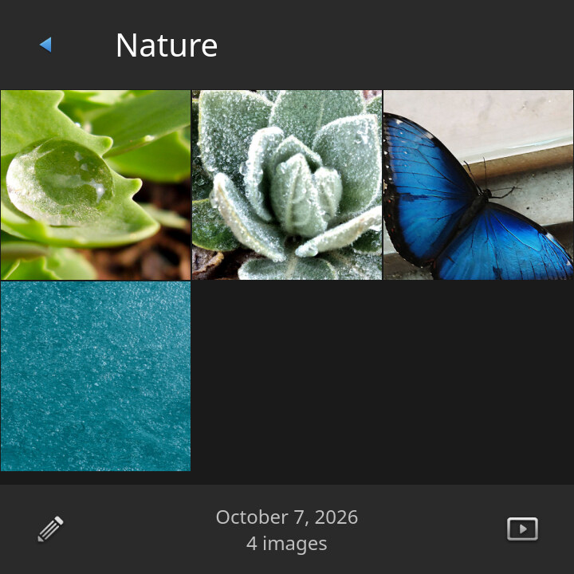 | 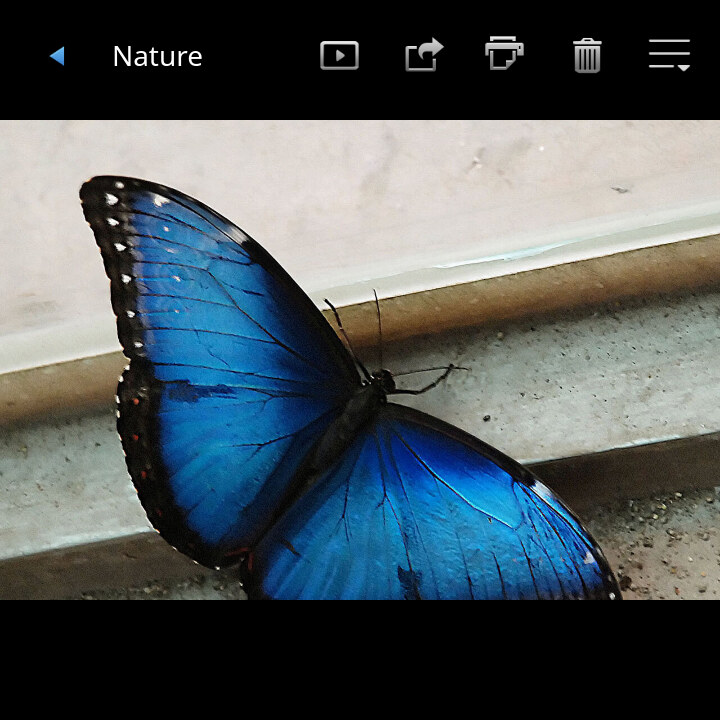 |
| Libraries | and albums, scrolled | An album | A picture |

Each device's slideshow and exhibition are in `docs/screenshots/` too.
The pictures are LuneOS's default wallpapers, made into a demo library;
`tools/screenshots-host.sh` takes all of these again (see below).

## Features

**Library**

- A panel of **libraries** - All Photos & Videos, the device, and each
  cloud account with photos (Dropbox, Box, OneDrive, HiDrive, MEGA,
  pCloud, Koofr and Yandex Disk have been tried) - and of **albums**: the camera's Photo roll,
  the device's folders with pictures or videos, the cloud accounts' albums
  with a cloud mark. Each album with its newest picture as a cover and how
  many pictures and videos it has.
- On a wide screen (the TouchPad) the panel is on the left and the library
  or album beside it; on a phone the panel is the first page and an album
  opens over it.
- New Album, Rename and Delete Album for the device's albums; Sync Now for
  a cloud account; Preferences & Accounts in the app menu, with how long a
  slideshow shows each photo.
- Asks once for permission to see the pictures
  (`com.palm.mediapermissions`), as the other media apps do.

**Albums**

- A grid of pictures and videos, newest first; a video with its length.
- Select (one by one, all, none) to **add to another album** - a device
  album, or a cloud album, which uploads them - or to **delete**, from a
  cloud account as well.
- Slideshow of the album.

**Pictures and videos**

- Full screen, swiped through the album; pinch or double-tap to zoom (up
  to three times), and drag about.
- A tap shows the bar: Slideshow from here, Share (email), Comments where
  the account has them, Print, Delete, and More: Add to Album, Set As
  Wallpaper.
- Videos play in place, with their own bar.

**Slideshow and exhibition**

- A slideshow of an album, the library, or from a picture; a swipe goes
  on, a tap ends it; the screen stays on while it plays.
- Exhibition (dock mode): the slideshow in the dock window, of the albums
  chosen in Preferences or of all.

**Opened from other apps**

`appinfo.json` registers the app for JPEG, PNG, GIF, BMP and WebP. Launch
parameters:

    {"albumID": "<db8 id>", "pictureID": "<db8 id>"}   webOS's: that album or picture
    {"target": "/media/internal/DCIM/photo.jpg"}       a file of the library
    {"windowType": "dockModeWindow", "dockMode": true} exhibition
    {"snapshot": "/tmp/photos.png"}                    for tests: a picture of the window

## Depends on

- [luneos-components](https://github.com/webOS-ports/luneos-components):
  `LuneOS.Components`, the LuneOS Qt Quick Controls style, and on a
  development machine its QML stand-ins for the C++ plugins.
- `com.palm.service.photos` (app-services) for the cloud albums, with the
  cloud connectors of
  [luneos-synergy-connectors](https://github.com/webOS-ports/luneos-synergy-connectors)
  for the accounts; the media indexer for the device's pictures. Without
  the photos service the app shows the device's pictures only.

## On a development machine

The app runs and is tested on a PC with no device: luneos-components
ships QML stand-ins for its C++ plugins (`test/imports`), and
`tests/mocks/` stands in for the bus (db8, the photos service, accounts,
the system and print services) and the video engine. The library is the
one in `tests/Fixtures.js`, over the files in `tests/data/`.

You need a Qt 6 and luneos-components built against **that same Qt**,
checked out next to this repository (`../luneos-components`). On Debian
and Ubuntu that is the system Qt: `qt6-declarative-dev-tools` for
`qmltestrunner`, and `qml-qt6` for the `qml` runtime. A Qt from the
online installer (`~/Qt/6.x`) cannot load plugins built against the
system's.

### Run

    ./run-desktop.sh                          # the TouchPad
    ./run-desktop.sh --profile=mindphone      # another device
    ./run-desktop.sh --profile=q25 --ui-scale=1.25

The profiles are luneos-components' (`tp`, `mindphone`, `q25`, `n5`,
`radon`, ...). Every bus call and app launch is printed; settings go to
`build/desktop/`. `COMPONENTS` and `QMLBIN` override where
luneos-components and `qml` are.

### Tests

    tests/run-tests.sh

- `tst_library`: the logic in `qml/js/Library.js`.
- `tst_store`: `PhotoStore` against the stand-in bus: the library from
  db8, the photos service, permission, sync, adding, deleting, albums.
- `tst_ui`: the app itself on the TouchPad, the mindphone and the Q25 -
  the library, sources, albums, renaming, new and empty albums, adding
  photos, selecting, adding to an album (a cloud one too), deleting from
  the cloud, pictures and their actions, comments, video, the slideshow,
  exhibition, launch parameters, the app menu. Each state is saved to
  `build/test-output/ui/<device>-<state>.png` to look at.

`PROFILES`, `TESTS` and `UI_TESTS` pick what runs, for example
`PROFILES=q25 TESTS= tests/run-tests.sh`. The same tests are CTest tests:

    cmake -S . -B build/cmake && ctest --test-dir build/cmake

There is no C++ in the app, so no compiler, sanitizer or C/C++ static
analysis applies.

### Qt Creator

**Run:** open `photos.qmlproject`. In Projects, use a kit whose Qt is the
one luneos-components was built against (on Debian/Ubuntu add
`/usr/lib/qt6/bin/qmake6` under Preferences > Kits > Qt Versions and make
a kit with it), then Run. That is the QML Runtime with the project's
import paths and the LuneOS style. It shows luneos-components' default
`desktop` profile (600x800), because the device comes from a command-line
flag that the QML Runtime run cannot place. For a device, add a run
configuration in Projects > Run > Add > Custom Executable: the executable
is `run-desktop.sh` in the checkout, the arguments `--profile=mindphone`
(or another device). One configuration per device lets you switch between
them in the run selector.

**Tests:** open `CMakeLists.txt` as well (it builds nothing) and switch
on CTest in Preferences > Testing. The tests then show in the Tests pane
and Test Results as `library`, `store`, `ui-tp`, `ui-mindphone` and
`ui-q25`. Set `LUNEOS_COMPONENTS` or `QMLTESTRUNNER`
in the CMake configuration if they are not where `tests/run-tests.sh`
looks.

### Screenshots

    tools/screenshots-host.sh [folder with the wallpapers]

makes the demo library (`tools/make-demo-library.sh`: the LuneOS default
wallpapers, cloned from GitHub at the revision the image builds when no
folder is given, cut to camera proportions) and runs
`tests/screens/tst_screens.qml` on each device. That walks the screens
above and writes `docs/screenshots/<device>-<screen>.jpg`. It needs
ImageMagick.

## On a device

    tools/install.sh <adb serial>
    tools/install.sh ssh:<host>[:<port>]      e.g. ssh:localhost:5522, a VM

packs the app into an ipk and installs it through
`com.webos.appInstallService`, as Preware does. The
`org.webosports.app.photos` recipe in meta-luneos still builds the old
Enyo app; it is to install this one by copying, as the Videos recipe
does.

## Pictures and icon

The app's pictures are webOS 3.0's Photos & Videos artwork, redrawn as SVG
(`artwork/`): the toolbar keys with their pressed glow, the library icons,
the selection frame, the video marks and the empty album. The app shows
PNGs only, drawn from those SVGs, which are kept to be changed and drawn
again:

    tools/make-images.sh      artwork/*.svg -> qml/images/{1x,2x,3x}/*.png
    tools/make-icon.sh        icon.svg -> icon.png, icon-256x256.png

A picture is drawn at its SVG's own size at grid unit 10 (the TouchPad,
webOS's own scale), the legacy pixel size, unless `artwork/sizes` gives
another; `2x/` and `3x/` are twice and three times that, and
`qml/js/Images.js` picks the smallest set that is not too small for the
screen, so a picture is only ever made smaller. Both scripts draw with
Qt's own SVG renderer, filters included. After changing an SVG, run
`tools/make-images.sh` and commit the PNGs with it.

## Licence

GNU General Public License version 3 (GPL-3.0-only), see `COPYING`.
